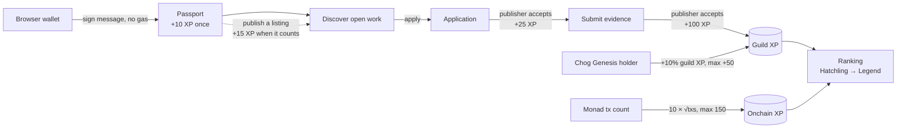
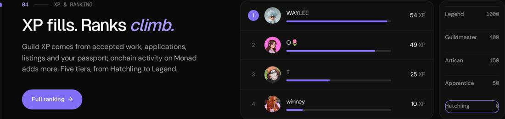

<p align="center">
  
</p>

<h1 align="center">Choguild</h1>

<p align="center">
  <strong>Ship work. Earn your <em>rank.</em></strong><br />
  The contributor guild on Monad: a wallet-signed passport, a board of open work, and a public ladder of everything that got accepted.
</p>

<p align="center">
  <a href="https://choguild.vercel.app"><b>choguild.vercel.app</b></a> ·
  <a href="https://choguild.vercel.app/docs">Docs / whitepaper</a> ·
  <a href="#for-chogathon-judges">For judges</a>
</p>

<p align="center">
  <a href="https://choguild.vercel.app"></a>
  <a href="LICENSE"></a>
  
  
</p>

<p align="center">
  
</p>
<p align="center">
  
  &nbsp;
  
  &nbsp;
  
</p>

Everything on the site is real. Listings, passports, XP and onchain counts come straight from Postgres and Monad mainnet. Nothing is seeded, and an empty state means nobody has done that yet.

## What it is

Contributors in an ecosystem do real work across chats, docs and repos, but there is no shared record of what was asked for, who did it, and whether it was accepted. Choguild is that record:

1. **Passport:** an identity anchored to a Monad wallet. Editing it takes a signed message, never a transaction.
2. **Board:** passport holders publish listings with terms, deadline, positions and skills.
3. **Review loop:** publishers accept applications, then review the evidence contributors submit.
4. **Ladder:** XP is computed from accepted events plus Monad activity, with rules that make farming unprofitable.

## Features

| | |
| --- | --- |
| **Passport** | Single **Connect wallet** button (EIP-6963 injected wallets). Sign-In with Ethereum, 7-day session, no gas. Profile with display name, username, bio, skills, interests and links. **Avatar upload with live preview** (PNG/JPEG/WebP/GIF up to 10 MB, resized in the browser to 512×512, stored under 300 KB) or one of your Chogs. |
| **Open work** | `/discover`: search and filter by skill, category, compensation and status. Holders-only listings are marked. |
| **Applications & submissions** | Apply with a pitch, track status (Submitted → Under review → Shortlisted → Accepted / Rejected / Withdrawn). Once accepted, submit versioned evidence links; publishers accept, request changes or reject. |
| **XP & ranking** | `/ranking`: Overall, Guild work or Onchain views, five tiers, live XP bars. |
| **Chog Genesis perks** | Contract [`0xc96d31F8626c6D03Fae5dCD3d61e3FB9F4a73763`](https://monadscan.com/token/0xc96d31F8626c6D03Fae5dCD3d61e3FB9F4a73763). Holder badge, **+10% guild XP (rounded, max +50)**, access to holders-only listings, Chog as avatar. |
| **Onchain proofs** | Each passport wallet's Monad transaction count becomes onchain XP. `/network` shows live Monad mainnet status. |
| **Publish** | `/opportunities/new`: drafts, holders-only gating, review queue per listing. |
| **Docs / whitepaper** | `/docs`: whitepaper, how it works, passport, listings, XP, onchain proofs, Chog perks, FAQ. Sidebar, mobile menu, on-page table of contents. |
| **Light / dark** | Header toggle, remembers your choice, follows the OS by default, no flash on load. |
| **Fast jumps** | Header links jump to each home section (active section highlighted). ⌘K / Ctrl+K opens a page and action palette. |

## How it works



| Action | XP |
| --- | --- |
| Accepted submission | +100 |
| Accepted application | +25 |
| Published listing (counts once another wallet's work is accepted on it or it stays open 72 h; max 4 per 30 days) | +15 |
| Saved public passport | +10 (once) |
| Onchain activity on Monad mainnet | 10 × √(transactions sent), max +150 |

Anti-farming (`src/lib/ranking/farming.ts`): self-dealing earns nothing; jobs between the same two wallets (either direction) earn full, then half, then nothing; guild XP is capped at **400 per wallet per 30 days**. Tiers (`src/lib/ranking/xp.ts`): **Hatchling** 0 · **Apprentice** 50 · **Artisan** 150 · **Guildmaster** 400 · **Legend** 1000.

<p align="center">
  
</p>

## For Chogathon judges

**60-second tour:** open [choguild.vercel.app](https://choguild.vercel.app) and scroll the home page; each numbered section is one feature, animated with real data. Then [Discover](https://choguild.vercel.app/discover), [Ranking](https://choguild.vercel.app/ranking), a passport such as [/passport/octoberry](https://choguild.vercel.app/passport/octoberry), and the [Docs](https://choguild.vercel.app/docs). For the full loop: **Connect wallet** → sign once → save a passport → apply to a listing.

| Look at | Where | Why it matters |
| --- | --- | --- |
| Wallet-signed identity | `/passport` | SIWE session, no seed phrase, no gas. Avatar is an upload or a Chog you own (checked live with `ownerOf`). |
| Real work loop | `/discover` → apply → `/submissions` | Only accepted work earns XP. |
| Honest ranking | `/ranking`, `/docs/xp` | XP is recomputed from the database plus Monad tx counts, with anti-farming rules. |
| Chog Genesis perks | badge, +XP, gated listings | Every check reads the official contract on Monad mainnet. |
| Craft | the whole site | Own design system (flat neutrals + Monad purple, no gradients), light/dark, scroll-triggered diagrams that only animate transform/opacity. |

**Verify the Chog perks yourself:** `node scripts/chog-live-check.mjs` reads `name`, `totalSupply`, `ownerOf` and `balanceOf` from the contract over the public RPC and checks `/api/chog/:id` on the live site. `npm run test:chog-live` runs the server-side holder checks against a real holder and a non-holder.

## Tech stack

- [TanStack Start](https://tanstack.com/start) (React 19, file-based routing, server functions), deployed on Vercel through Nitro
- Tailwind CSS v4, Radix UI primitives, `cmdk`, `lucide-react`
- Type: Geist Sans (headings, UI), DM Sans (body), Geist Mono (labels), all self-hosted via Fontsource
- `wagmi` (injected connector only) + `viem` on Monad mainnet (chain id 143); SIWE sessions
- Postgres via `pg` (Neon in production) or in-memory [PGLite](https://pglite.dev) locally
- `zod` validation on every server function; per-client rate limits

## Architecture

```
Browser (React 19, wagmi injected)
   │  server functions (zod-validated, rate-limited)
   ▼
TanStack Start on Vercel (Nitro) ──► Postgres (Neon) / PGLite locally
   │
   ├─► Monad RPC: tx counts (batched, cached 10 min in memory + Postgres, ≤1.5 s budget)
   └─► Chog Genesis contract: ownerOf snapshot via Multicall3 (5 min cache), live balanceOf / ownerOf on gated actions
```

```
src/
  routes/          pages (file-based): /, discover, passport, ranking, submissions, applications, opportunities, network, how-it-works, docs, api
  components/      layout shell, home sections, docs, board, passport, work, ranking, chog
  lib/board/       listings and applications
  lib/work/        submissions and reviews
  lib/passport/    profiles, SIWE sessions, avatars, wallet config
  lib/ranking/     XP rules, anti-farming, tiers, ranking query
  lib/chog/        Chog Genesis holdings, boost, avatar checks
  lib/monad/       network status and onchain activity
migrations/        SQL schema, applied in order
scripts/           migrations, Chog live check, brand renderer
docs/media/        README screenshots
```

## Run it locally

Requires **Node 22** (`.nvmrc`).

```bash
npm install
npm run dev        # http://localhost:8080
```

No database is needed locally: PGLite starts in memory and applies `migrations/` on boot.

| Variable | Required | Purpose |
| --- | --- | --- |
| `DATABASE_URL` | For persistent data | Postgres connection string (Neon works). Without it data lives in memory. |
| `CHOG_SESSION_SECRET` | Yes, on deployed builds | ≥32 random characters (`openssl rand -hex 32`). Signs passport sessions. |
| `VITE_MONAD_RPC_URL` | No | Preferred Monad RPC (https). Add a custom host to `connect-src` in `vercel.json`. |
| `CHOG_RUN_MIGRATIONS` | No | Local/CI: `1` lets `npm run db:migrate` run outside Vercel. |

On Vercel, migrations run during `npm run build` only for production deploys with `DATABASE_URL` set.

## Tests and checks

```bash
npm run typecheck
npm run lint
npm test               # script tests + unit tests (ranking, farming, board, passport, chog, wallets…)
npm run test:chog-live # live Chog Genesis holder checks against Monad mainnet
npm run build
```

CI (`.github/workflows/ci.yml`) runs typecheck, lint, tests and build on Node 22 for every push and pull request.

## Wallets

Injected browser wallets only (MetaMask, Rabby…). No Coinbase SDK, no WalletConnect, no Phantom. On a phone with no injected wallet, tapping **Connect wallet** offers deep links that reopen the page inside a wallet app.

## Security

Enforced CSP and security headers in `vercel.json` (violations reported to `/api/csp-report`), zod-validated inputs, per-client rate limits, client errors logged via `/api/client-error`, no source maps shipped.

## License

[MIT](LICENSE)
