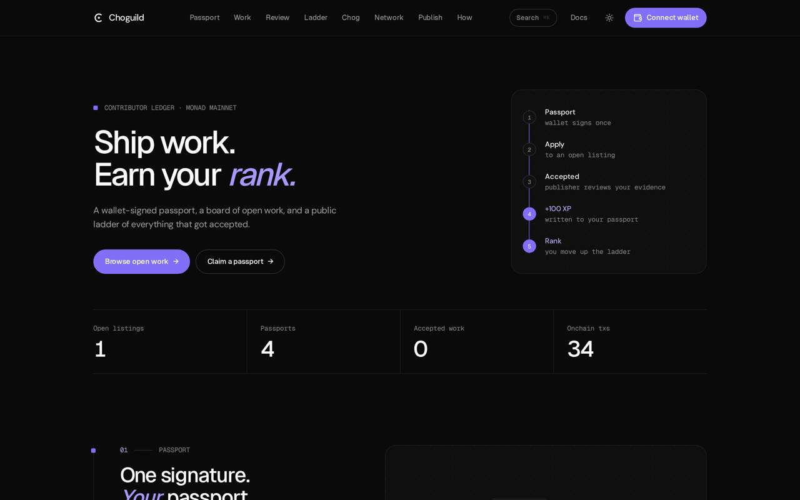
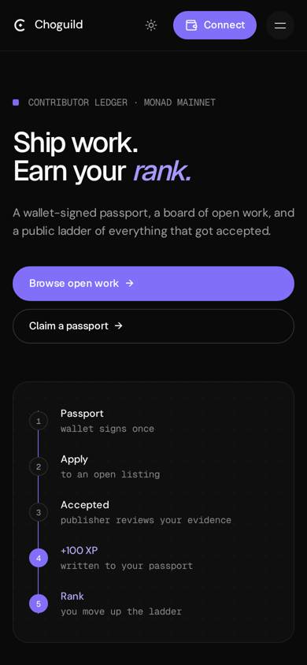
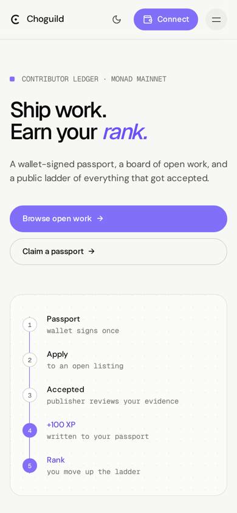
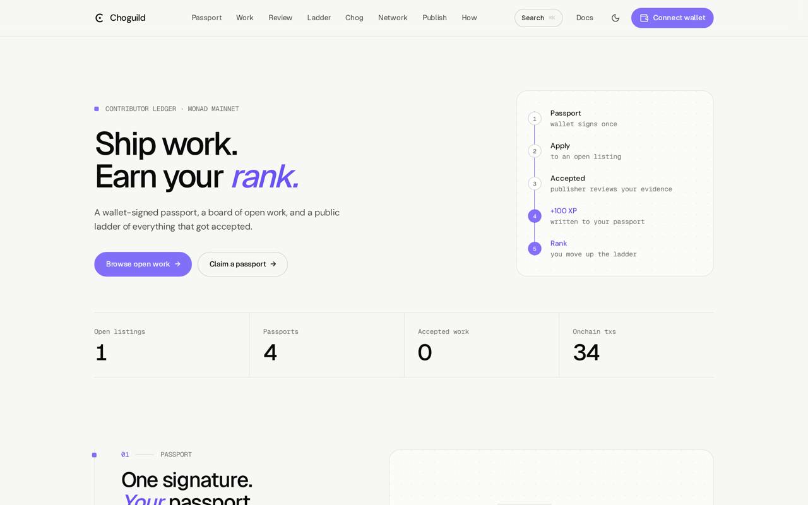
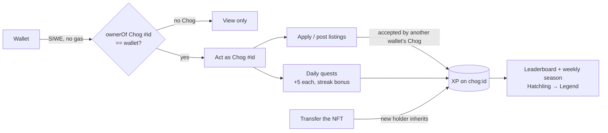

<p align="center">
  
</p>

<h1 align="center">Choguild</h1>

<p align="center">
  <strong>Your Chog is the <em>member.</em></strong><br />
  A work guild on Monad where each Chog Genesis NFT carries its own passport, XP, rank and work history, and takes them along when it changes hands.
</p>

<p align="center">
  <a href="https://choguild.vercel.app"><b>choguild.vercel.app</b></a> ·
  <a href="https://choguild.vercel.app/docs">Docs / whitepaper</a> ·
  <a href="#for-chogathon-judges">For judges</a>
</p>

<p align="center">
  <a href="https://choguild.vercel.app"></a>
  <a href="LICENSE"></a>
  
  
</p>

<p align="center">
  
</p>
<p align="center">
  
  &nbsp;
  
  &nbsp;
  
</p>

Everything on the site is real. Listings, passports, XP, quests and ownership come straight from Postgres and Monad mainnet. Nothing is seeded, and an empty state means nobody has done that yet.

## What it is

**Remove the NFT and Choguild stops working, by design.** The member is a [Chog Genesis](https://monadscan.com/token/0xc96d31F8626c6D03Fae5dCD3d61e3FB9F4a73763) token, not a wallet:

1. **Chog passport:** every profile, listing, application, submission and XP event is keyed to `chog:<tokenId>`. The card always shows the Chog's real art.
2. **Live ownership:** whoever holds the token right now (`ownerOf` on Monad) acts as it. Every write re-checks it. A wallet with several Chogs picks one; a wallet with none can only view.
3. **Reputation travels:** transfer a Chog and the new holder inherits its rank, tier, streak and history. Each Chog has a public record at `/chog/:id`.
4. **Chog-to-Chog work:** Chogs post listings, other Chogs take them, the poster's Chog reviews the evidence. The leaderboard ranks Chogs.
5. **Daily layer:** quests and streaks, level-up moments with tier frames, a weekly season leaderboard, and a shareable rank card for X.

## Features

| | |
| --- | --- |
| **Act as a Chog** | `/passport`: sign in once (SIWE, no gas), pick which Chog you hold to act as. Ownership checked live with `ownerOf`; transfers drop the Chog from the old holder's session. |
| **Chog card** | Real token image with a frame, title and glow that evolve by tier (Hatchling → Legend). |
| **Chog record** | `/chog/:id`: live holder, rank, season rank, XP split (work / quests), streak, accepted work. |
| **Daily quests + streaks** | Check in, scout an open listing, size up a rival Chog. Check-ins add +1 XP per streak day (max +10). One Chog per wallet per quest per day. |
| **Level-up moments** | When a Chog reaches a new tier its holder gets confetti and the new tier card. |
| **Weekly seasons** | `/ranking?by=season`: Monday-to-Monday (UTC) leaderboard; Season 1 began 19 Oct 2026. |
| **Rank card for X** | 1200×675 PNG drawn in the browser (art, tier frame, rank, season, XP, streak), download or share sheet, plus a prefilled X post linking the record. |
| **$CHOG tips** | On any Chog's record, tip its live holder in [$CHOG](https://monadscan.com/token/0x350035555E10d9AfAF1566AaebfCeD5BA6C27777) (address from chog.xyz, verified onchain: name "Chog", symbol "CHOG", 18 decimals). Plain ERC-20 transfer from your wallet, no escrow. |
| **Listings & reviews** | `/discover`, `/opportunities/new`, `/applications`, `/submissions`: the full post → apply → submit → accept loop, all as Chogs. |
| **Docs / whitepaper** | `/docs`: the Chog-as-member model, quests and seasons, XP and anti-farming, FAQ. |
| **Light / dark** | Header toggle, remembers your choice, no flash on load. |

## How it works



| Action | XP |
| --- | --- |
| Accepted submission | +100 |
| Accepted application | +25 |
| Published listing (counts once another Chog's work is accepted on it or it stays open 72 h; max 4 per 30 days) | +15 |
| Saved public passport | +10 (once) |
| Daily check-in | +5, +1 per streak day (max +10 bonus) |
| Scout an open listing / visit a rival Chog | +5 each, once a day |

Anti-farming (`src/lib/ranking/farming.ts`, `src/lib/chog/actor.server.ts`, `migrations/0010_chog_is_member.sql`): a Chog can't accept its own work; **Chogs held by the same wallet can't apply to, accept or review each other and earn no XP from each other**; jobs between the same two Chogs earn full, then half, then nothing; work XP is capped at **400 per Chog per 30 days**; each daily quest counts once per wallet per day, however many Chogs it holds.

**Migration from wallet passports:** passports whose wallet held a Chog in the last ownerOf snapshot moved, with their history, onto that wallet's lowest-numbered Chog. The rest were copied to `archived_wallet_passports` and hidden; if such a wallet later acts as a Chog with no passport, its old record moves onto that Chog.

## For Chogathon judges

**60-second tour:** open [choguild.vercel.app](https://choguild.vercel.app), then the [leaderboard](https://choguild.vercel.app/ranking), the [season](https://choguild.vercel.app/ranking?by=season), any Chog's record such as [/chog/12](https://choguild.vercel.app/chog/12), and the [docs](https://choguild.vercel.app/docs). With a wallet holding a Chog: **Connect wallet** → sign → pick your Chog → check in → save its passport → share the rank card.

| Look at | Where | Why it matters |
| --- | --- | --- |
| NFT is the core | `/passport`, `/chog/:id` | No Chog, no membership. Records are keyed to the token, ownership is live `ownerOf`. |
| Reputation travels | `/chog/:id` "Held by" | Transfer the Chog and its rank goes with it. |
| Fun and retention | quests, streak, level-up, season | A reason to come back daily and weekly. |
| Honest ranking | `/ranking`, `/docs/xp` | XP recomputed from events, with per-Chog and same-wallet anti-farming. |

**Verify the chain reads yourself:** `node scripts/chog-live-check.mjs` reads `name`, `totalSupply`, `ownerOf` and `balanceOf` from the contract over the public RPC. `npm run test:chog-live` runs the server-side ownership checks against a real holder and a non-holder.

## Tech stack

- [TanStack Start](https://tanstack.com/start) (React 19, file-based routing, server functions), deployed on Vercel through Nitro
- Tailwind CSS v4, Radix UI primitives, `cmdk`, `lucide-react`
- Type: Geist Sans (headings, UI), DM Sans (body), Geist Mono (labels), all self-hosted via Fontsource
- `wagmi` (injected connector only) + `viem` on Monad mainnet (chain id 143); SIWE sessions
- Postgres via `pg` (Neon in production) or in-memory [PGLite](https://pglite.dev) locally
- `zod` validation on every server function; per-client rate limits

## Architecture

```
Browser (React 19, wagmi injected)
   │  server functions (zod-validated, rate-limited)
   ▼
TanStack Start on Vercel (Nitro) ──► Postgres (Neon) / PGLite locally
   │
   ├─► Monad RPC: tx counts (batched, cached 10 min in memory + Postgres, ≤1.5 s budget)
   └─► Chog Genesis contract: live ownerOf before every write (30 s cache for reads), holder snapshot via Multicall3 (5 min)
```

```
src/
  routes/          pages (file-based): /, discover, passport, ranking, submissions, applications, opportunities, network, how-it-works, docs, api
  components/      layout shell, home sections, docs, board, passport, work, ranking, chog
  lib/board/       listings and applications
  lib/work/        submissions and reviews
  lib/passport/    profiles, SIWE sessions, avatars, wallet config
  lib/ranking/     XP rules, anti-farming, tiers, ranking query
  lib/chog/        Chog-as-member actor keys, live ownerOf, holdings, legacy adoption
  lib/quests/      daily quests, streaks, weekly seasons
  lib/monad/       network status and onchain activity
migrations/        SQL schema, applied in order
scripts/           migrations, Chog live check, brand renderer
docs/media/        README screenshots
```

## Run it locally

Requires **Node 22** (`.nvmrc`).

```bash
npm install
npm run dev        # http://localhost:8080
```

No database is needed locally: PGLite starts in memory and applies `migrations/` on boot.

| Variable | Required | Purpose |
| --- | --- | --- |
| `DATABASE_URL` | For persistent data | Postgres connection string (Neon works). Without it data lives in memory. |
| `CHOG_SESSION_SECRET` | Yes, on deployed builds | ≥32 random characters (`openssl rand -hex 32`). Signs passport sessions. |
| `VITE_MONAD_RPC_URL` | No | Preferred Monad RPC (https). Add a custom host to `connect-src` in `vercel.json`. |
| `CHOG_RUN_MIGRATIONS` | No | Local/CI: `1` lets `npm run db:migrate` run outside Vercel. |

On Vercel, migrations run during `npm run build` only for production deploys with `DATABASE_URL` set.

## Tests and checks

```bash
npm run typecheck
npm run lint
npm test               # script tests + unit tests (ranking, farming, board, passport, chog, wallets…)
npm run test:chog-live # live Chog Genesis holder checks against Monad mainnet
npm run build
```

CI (`.github/workflows/ci.yml`) runs typecheck, lint, tests and build on Node 22 for every push and pull request.

## Wallets

Injected browser wallets only (MetaMask, Rabby…). No Coinbase SDK, no WalletConnect, no Phantom. On a phone with no injected wallet, tapping **Connect wallet** offers deep links that reopen the page inside a wallet app.

## Security

Enforced CSP and security headers in `vercel.json` (violations reported to `/api/csp-report`), zod-validated inputs, per-client rate limits, client errors logged via `/api/client-error`, no source maps shipped.

## License

[MIT](LICENSE)
