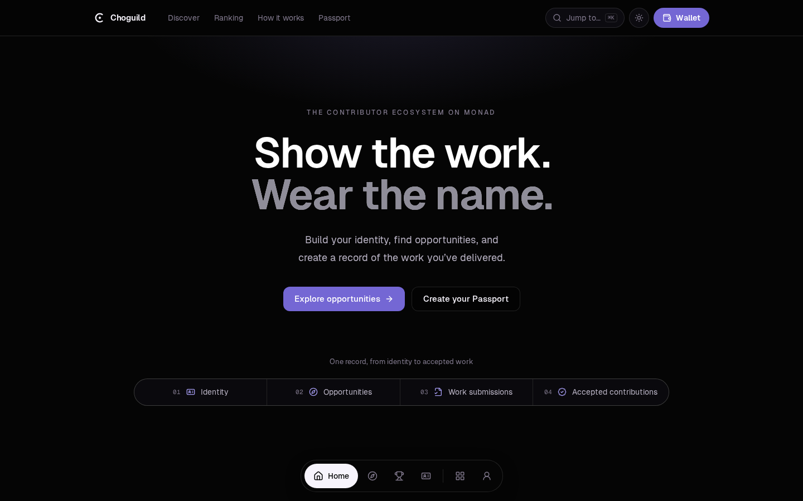
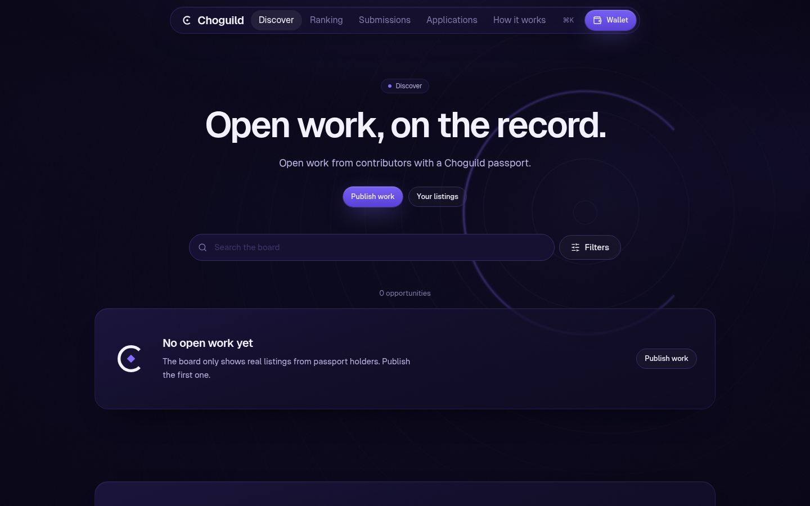
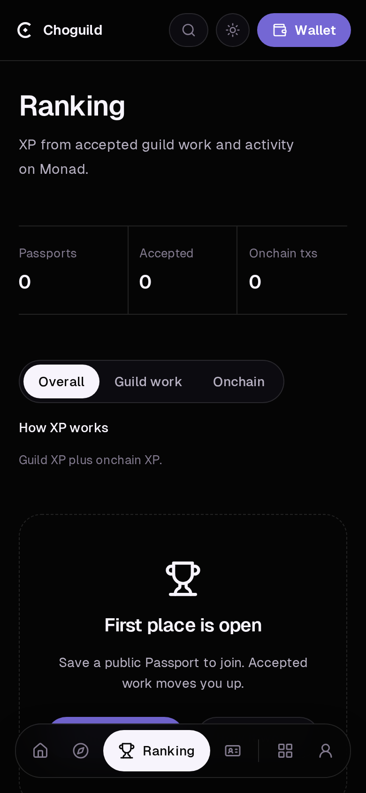

<p align="center">
  
</p>

<h1 align="center">Choguild</h1>

<p align="center">
  <strong>Get work and earn your rank.</strong><br />
  A contributor guild for the Monad ecosystem: a passport for your name, a board of open work, and a record of reviewed contributions.
</p>

<p align="center">
  <a href="https://choguild.vercel.app"></a>
  <a href="LICENSE"></a>
  
</p>

<p align="center">
  
</p>

<p align="center">
  
  &nbsp;
  
</p>

Everything on the site is real: listings, passports, and XP come straight from the database and Monad mainnet. There is no seeded or demo content; an empty board means nobody has published yet.

---

## What it does

| Area | What you can do |
| --- | --- |
| **Passport** | Connect a browser wallet (or open the site in your wallet app on a phone), sign a message (Sign-In with Ethereum, never a transaction), and save a public profile with your skills and links. |
| **Discover** | Browse the opportunity board. Search and filter by skill, category, compensation, and status. |
| **Opportunities** | Publish open work, edit your listings, and review the applications they receive. |
| **Applications** | Track what you applied to and where each application stands. |
| **Submissions** | Once accepted, submit evidence of the work. Reviewed submissions build your contribution history. |
| **Ranking** | The Chog ladder: every public passport ranked by guild XP and onchain Monad activity, with Overall / Guild work / Onchain views and a top-3 podium. |
| **How it works** | The full loop, the XP table, the five ranks, and an FAQ. |
| **Network** | Live Monad mainnet status for the RPC the app uses. |

A connected wallet is only an address. Nothing is treated as an account until you sign and save a passport, and Choguild never asks for a seed phrase or private key.

## XP and ranks

XP is calculated live from the database, so it can't drift out of sync with the board.

| Action | XP |
| --- | --- |
| Accepted submission | +100 |
| Accepted application | +25 |
| Published opportunity: counts once another wallet's work is accepted on it or it stays open 3 days (max 4 per 30 days) | +15 |
| Saved public passport | +10 |
| Onchain activity on Monad mainnet | 10 × √(transactions sent), up to +150 |

Anti-farming (`src/lib/ranking/farming.ts`): self-dealing earns nothing; jobs between the same two wallets (either direction) earn full XP the first time, half the second, nothing after; guild XP from work and listings is capped at 400 per wallet per 30 days.

Onchain XP reads each passport wallet's transaction count from the public Monad RPC (batched for every wallet, cached for 10 minutes in memory and in Postgres; pages never wait more than ~1.5 s on the RPC and show "unavailable" rather than 0 when it is down). The square root and the cap mean steady activity counts, but spamming transactions can't outrank reviewed guild work, and balances are never used. The Ranking page can sort by **Overall**, **Guild work**, or **Onchain**.

Ranks: **Hatchling** (0) → **Apprentice** (50) → **Artisan** (150) → **Guildmaster** (400) → **Legend** (1000). The rules live in `src/lib/ranking/xp.ts`.

## Getting around

- A **floating dock** at the bottom of every screen holds the main pages (Home, Discover, Ranking, Passport). Its **More** and **Account** buttons morph it open into panels for the remaining pages, quick actions, what's new, and your passport status.
- **⌘K / Ctrl+K** opens a jump menu for every page and common action.
- The header has search, a **light/dark toggle**, and Wallet. Detail pages show a **Back** control.

## Tech stack

- [TanStack Start](https://tanstack.com/start) (React 19, file-based routing, server functions)
- Tailwind CSS v4, Radix UI primitives, Motion, `cmdk`, `lucide-react`; Geist and Geist Mono
- Upstream Monad RPC reads are cached in-process (stale-while-revalidate, with a failure backoff) so a slow RPC never blocks a page render
- `wagmi` + `viem` for wallets and Monad; SIWE for passport sessions
- Postgres via `pg` when `DATABASE_URL` is set, otherwise an in-memory [PGLite](https://pglite.dev) database
- Deployed on Vercel through Nitro

## Run it locally

Requires Node 22 (see `.nvmrc`).

```bash
npm install
npm run dev        # http://localhost:8080
```

No database is needed for local work: PGLite starts in memory and applies `migrations/` on boot.

### Checks

```bash
npm run typecheck
npm run lint
npm test
npm run build
```

## Configuration

Copy `.env.example` into your host's environment settings. Do not commit real values.

| Variable | Required | Purpose |
| --- | --- | --- |
| `DATABASE_URL` | For persistent data | Postgres connection string (Neon works well). Without it, data lives in memory and resets when the server restarts. |
| `CHOG_SESSION_SECRET` | Yes, on every deployed build | At least 32 random characters (`openssl rand -hex 32`). Signs passport sessions. |
| `VITE_MONAD_RPC_URL` | No | Preferred Monad RPC (https only). The app falls back through rpc1–3.monad.xyz, monadinfra, dRPC and Ankr automatically. A custom host must also be added to `connect-src` in `vercel.json` (the CSP is enforced). |
| `CHOG_RUN_MIGRATIONS` | No | Local/CI only: `1` lets `npm run db:migrate` run outside Vercel. |

## Deploy to Vercel

1. Import the repository in Vercel. The framework preset can stay on **Other**; `vercel.json` and the Nitro build output handle the rest.
2. Add `CHOG_SESSION_SECRET` and `DATABASE_URL`. Without `DATABASE_URL` the deployed app runs on in-memory PGLite and every cold start wipes the data.
3. Deploy. `npm run build` runs the database migrations only on **production** deploys (`VERCEL_ENV=production`) with `DATABASE_URL` set. Preview and development builds never touch the schema. Run them by hand with `CHOG_RUN_MIGRATIONS=1 npm run db:migrate`.
4. Without `CHOG_SESSION_SECRET` every public page still renders; only sign-in is unavailable.

## Wallets

Browser wallets only (EIP-6963 injected: MetaMask, Rabby, Phantom…). There is no WalletConnect and no Coinbase SDK. On a phone with no injected wallet, the Wallet panel offers buttons that reopen the current page inside MetaMask, Phantom or Trust Wallet, and a copy-link button for Rabby and Rainbow (they publish no open-URL link).

## CI

`.github/workflows/ci.yml` runs typecheck, lint, tests and a build on Node 22 for every push and pull request. Vercel installs production dependencies only, so lint and tests are gated by CI rather than the Vercel build.

## Chog Genesis holders

- Contract: [`0xc96d31F8626c6D03Fae5dCD3d61e3FB9F4a73763`](https://monadscan.com/token/0xc96d31F8626c6D03Fae5dCD3d61e3FB9F4a73763) (Chog Genesis, CHOG, ERC-721, 1,969 tokens), as used by the official mint site mint.chog.xyz.
- Holdings are read onchain: `ownerOf(1..totalSupply)` through Multicall3 builds an owner snapshot, cached server-side for 5 minutes (`src/lib/chog/holders.server.ts`). Images come from each token's `tokenURI` on IPFS via `/api/chog/:id` (edge-cached).
- Holders get a "Chog holder" badge and their Chog on the passport and in ranking rows, plus **+10% guild XP, rounded, capped at +50** (onchain XP is not boosted). Documented in the XP table on How it works.
- Publishers can mark a listing "Chog holders only". The server re-checks `balanceOf` live when someone applies; if Monad can't be reached the application is refused rather than let through.

## Security and operations

- Security headers (`nosniff`, frame denial, referrer and permissions policy, an enforced CSP with violations sent to `/api/csp-report`) and long cache headers for static assets live in `vercel.json`.
- Every server function validates its input with zod (`src/lib/schemas.ts`) and writes are rate limited per client (`src/lib/rate-limit.ts`, in-memory per instance).
- Client errors are reported to `/api/client-error` and show up in the Vercel function logs as `[client-error]`. No source maps are shipped.
- `robots.txt` is static; `/sitemap.xml` is generated from public listings and passports.

## Project layout

```
src/
  routes/          pages (file-based routing)
  components/      UI: layout shell, board, passport, work
  lib/board/       opportunities and applications
  lib/work/        submissions and reviews
  lib/passport/    profiles, SIWE sessions, wallet config
  lib/monad/       network status and onchain activity (tx counts)
  lib/ranking/     XP rules, tiers, and the ranking query
migrations/        SQL schema, applied in order
public/brand/      Choguild mark (SVG)
scripts/           migrations runner, brand renderer (og.jpg, touch icon)
```

## License

[MIT](LICENSE)
