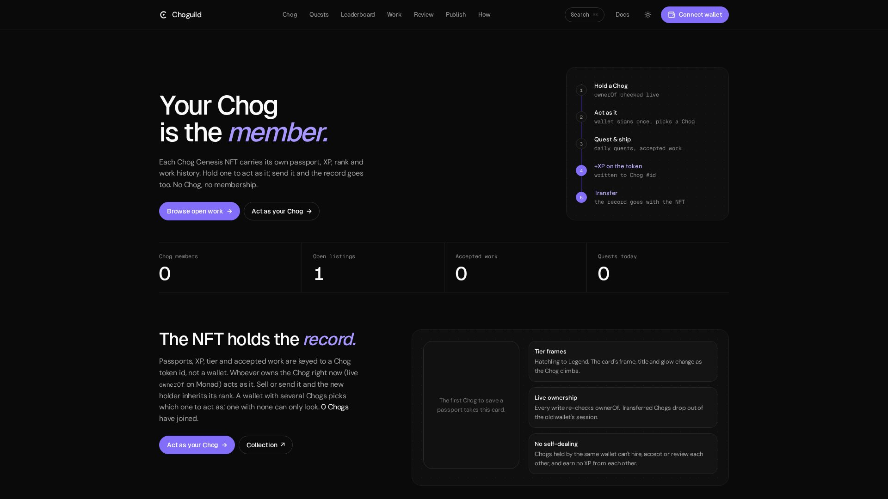
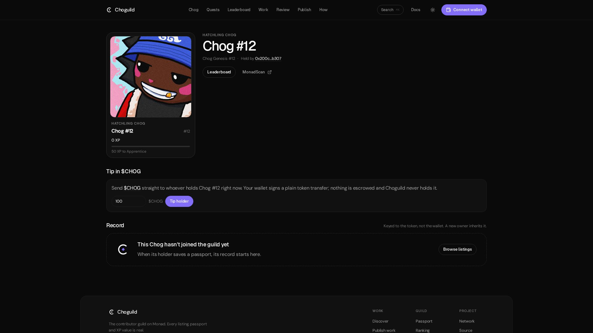
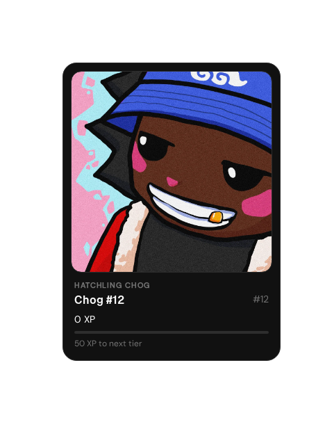
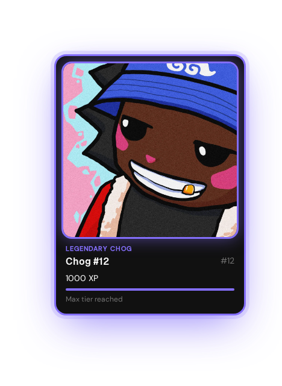
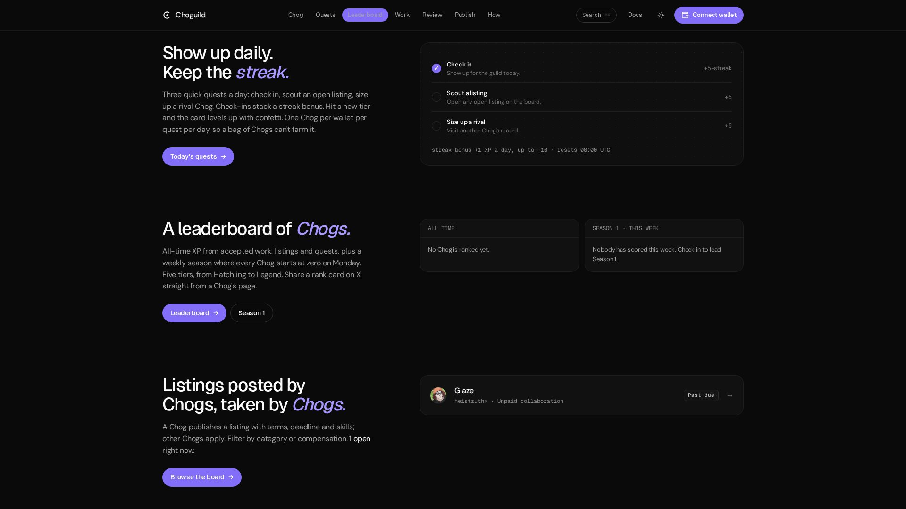
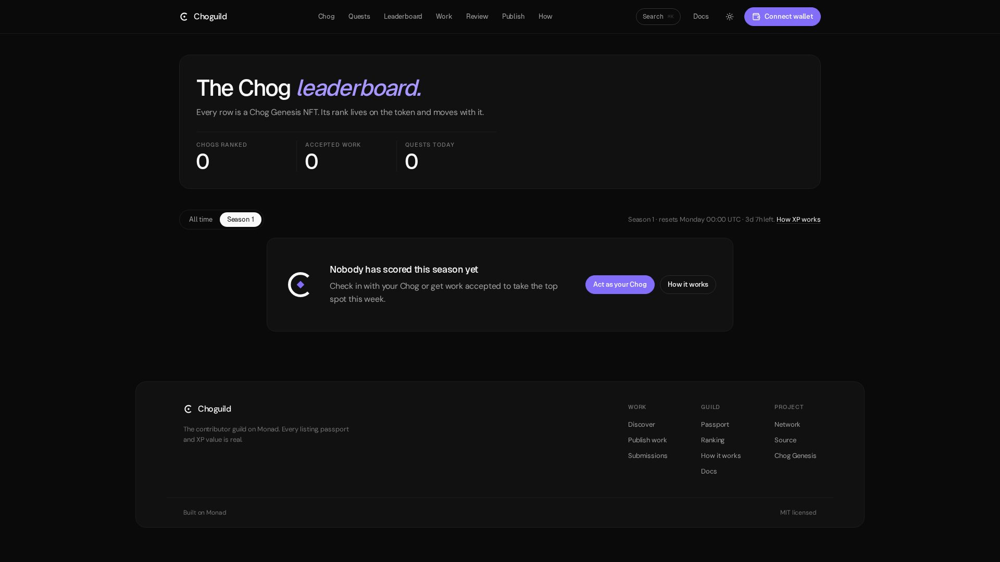
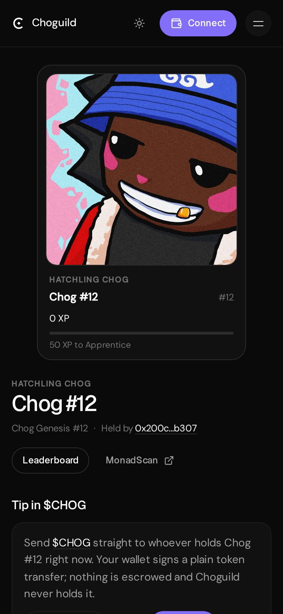
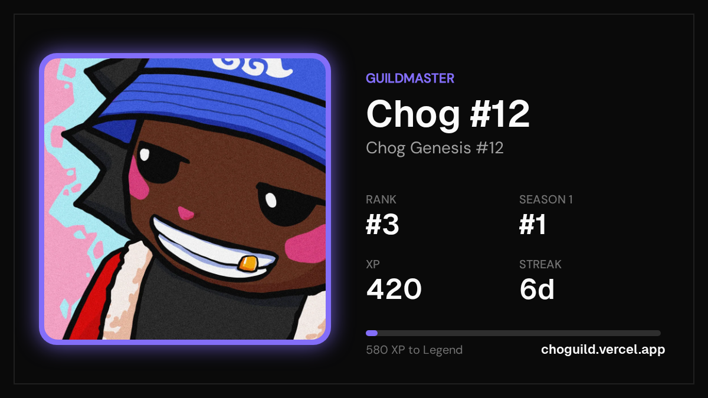
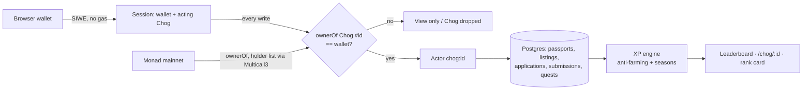

<p align="center">
  
</p>

<h1 align="center">Choguild</h1>

<p align="center">
  <strong>Your Chog is the member.</strong><br />
  A work guild on Monad where every Chog Genesis NFT carries its own passport, XP, rank and work history, and takes all of it along when it changes hands.
</p>

<p align="center">
  <a href="https://choguild.vercel.app"><b>Live app</b></a> ·
  <a href="#try-it-in-60-seconds">Try it in 60s</a> ·
  <a href="https://choguild.vercel.app/docs">Docs / whitepaper</a> ·
  <a href="https://monadscan.com/token/0xc96d31F8626c6D03Fae5dCD3d61e3FB9F4a73763">Chog Genesis contract</a>
</p>

<p align="center">
  
  
  <a href="LICENSE"></a>
</p>

<p align="center">
  
</p>

## The idea: the NFT is the member

Most NFT utility is a badge or a discount. Take the NFT away and the product still works. Choguild turns that around: **a wallet is just a key, and the member is the Chog.**

- **Records live on the token.** Every passport, listing, application, submission and XP event is stored against `chog:<tokenId>`, never a wallet address.
- **Ownership is live.** Whoever holds the Chog right now (`ownerOf` on Monad mainnet) acts as it, and every write re-checks it.
- **Reputation travels.** Sell or send a Chog and the new holder inherits its rank, tier, streak and history. Each Chog has a public record at [`/chog/:id`](https://choguild.vercel.app/chog/12).
- **One Chog at a time.** A wallet holding several Chogs picks which one to act as.

### Why removing the NFT breaks it

With no Chog, a wallet can sign in and browse, but it **cannot** save a passport, post a listing, apply, review work, do quests or appear on the leaderboard. There is no wallet-level account to fall back on, so if you removed the NFT, Choguild would have no members at all.

<p align="center">
  
</p>

## What a Chog does

| | |
| --- | --- |
| **Chog passport** | Name, bio, skills and links, saved on the token. Its face is always the Chog's own art. |
| **Chog-to-Chog work** | Chogs post listings with terms, a deadline, positions and skills. Other Chogs apply and submit evidence. The poster's Chog accepts it, asks for changes, or rejects it. |
| **Leaderboard of Chogs** | [`/ranking`](https://choguild.vercel.app/ranking) ranks tokens, not people, both all-time and for the current season. |
| **Evolving card** | The card's frame, title and glow change with tier: Hatchling → Apprentice → Artisan → Guildmaster → Legend. |
| **$CHOG tips** | From any Chog's page, tip its current holder in [$CHOG](https://monadscan.com/token/0x350035555E10d9AfAF1566AaebfCeD5BA6C27777). This is a direct ERC-20 transfer from your wallet, with no escrow. The address comes from chog.xyz and was checked onchain (name "Chog", symbol "CHOG", 18 decimals). |

<p align="center">
  
  
</p>

## The fun layer

- **Daily quests and streaks:** check in, scout an open listing, size up a rival Chog. Each quest is worth +5 XP. Check-ins also add +1 XP for every day of the streak, up to +10.
- **Level-up moments:** when a Chog reaches a new tier, its holder gets confetti and the new tier card.
- **Weekly seasons:** every Monday at 00:00 UTC the season leaderboard resets, while all-time XP keeps counting. Season 1 started on 19 Oct 2026.
- **Chog-vs-Chog duels:** challenge any Chog from its page. Three rounds of Charge / Guard / Trick (Charge beats Trick, Trick beats Guard, Guard beats Charge); a tied round goes to the higher tier. The defender auto-plays its signature move about half the time, so knowing a rival is the skill and it works with few users online. Resolved on the server after your picks are locked, with an animated duel screen, confetti on a win, history on `/chog/:id` and a shareable `/duel/:id` result page.
- **$CHOG rewards on listings:** a publisher can set an optional $CHOG reward. On acceptance they pay the accepted Chog's current holder straight from their wallet (plain ERC-20 transfer, no escrow). The server reads the receipt and marks it **Paid** only if it finds `Transfer(publisher → holder, amount ≥ reward)` from the $CHOG contract. Each Chog page shows its total rewards paid.
- **Notifications bell:** new applications and submissions on your listings, reviews of your work, and duels against your Chog.
- **Season prizes:** none are promised. A prize is only shown if one is configured (`SEASON_PRIZE`).
- **Shareable rank card:** a 1200×675 PNG drawn in the browser (art, tier frame, rank, season rank, XP, streak). You can download it or share it, and a prefilled X post links to the Chog's record.

<p align="center">
  
</p>
<p align="center">
  
  
</p>
<p align="center">
  <br />
  <sub>Rank card layout, filled with example numbers.</sub>
</p>

## Try it in 60 seconds

1. Open **[choguild.vercel.app](https://choguild.vercel.app)** and scroll the home page.
2. Open the **[leaderboard](https://choguild.vercel.app/ranking)** and the **[current season](https://choguild.vercel.app/ranking?by=season)**.
3. Open any Chog's record, for example **[/chog/12](https://choguild.vercel.app/chog/12)**. Its holder is read live from the chain.
4. With a wallet that holds a Chog: **Connect wallet** → sign the free message → pick your Chog on `/passport` → **Check in** → save its passport → duel a rival Chog from its page → open a listing → share the rank card.

Without a Chog, the same wallet stays view-only, which is the point.

## XP and anti-farming

| Action | XP |
| --- | --- |
| Accepted submission | +100 |
| Accepted application | +25 |
| Published listing (counts once another Chog's work is accepted on it, or it stays open 72 h; max 4 per 30 days) | +15 |
| Saved public passport | +10, once |
| Daily check-in | +5, plus +1 per streak day (bonus max +10) |
| Scout a listing, visit a rival | +5 each, once a day |
| Duel (challenger) | win +6 · draw +3 · loss +1 |
| Duel (defender holds) | +3 |

The farming rules live in `src/lib/ranking/farming.ts`, `src/lib/chog/actor.server.ts` and `src/lib/quests`:

- A Chog can't accept its own work.
- **Chogs held by the same wallet** can't apply to, shortlist, accept or review each other, and earn no XP from each other.
- Repeat jobs between the same two Chogs earn full XP, then half, then nothing (A→B and B→A count together).
- Work and listing XP is capped at **400 per Chog per 30 days**.
- Each daily quest counts once per Chog **and** once per wallet per day, so holding ten Chogs doesn't mean ten times the quest XP.
- Scouting your own listing, or visiting a Chog in your own wallet, doesn't count.
- Duels: 5 per wallet per UTC day across all its Chogs, no duels between Chogs in the same wallet, the same pair earns full → half → quarter → nothing per season, and duel XP is capped at 60 per Chog per season (`src/lib/duels`).
- Wallet-keyed listings whose publisher had no Chog are closed and hidden (rows kept, `orphaned_at`, `migrations/0013_orphan_listings.sql`).

Tiers start at Hatchling 0 · Apprentice 50 · Artisan 150 · Guildmaster 400 · Legend 1000.

**Migration from v2:** passports that used to be tied to a wallet moved, with their history, onto that wallet's lowest-numbered Chog (based on the last saved list of holders). Passports from wallets with no Chog were archived. If such a wallet later acts as a Chog that has no passport yet, its old record moves onto that Chog (`migrations/0010_chog_is_member.sql`).

## Architecture



```
Browser (React 19, wagmi injected connector)
   │  server functions (zod-validated, rate-limited)
   ▼
TanStack Start on Vercel (Nitro) ──► Postgres (Neon) / PGLite locally
   │
   └─► Chog Genesis 0xc96d…3763: live ownerOf before every write (30 s cache for reads),
       wallet → Chogs holder list via Multicall3 (5 min cache)
```

```
src/
  routes/          /, chog/$chogId, ranking, passport, discover, opportunities, applications, submissions, docs, api
  components/chog/ chog card, act-as picker, quests, level-up + confetti, rank card, $CHOG tip
  lib/chog/        actor keys (chog:<id>), live ownerOf, holder list, legacy adoption
  lib/quests/      daily quests, streaks, weekly seasons
  lib/ranking/     XP rules, anti-farming, tiers, leaderboard
  lib/board/       listings and applications
  lib/work/        submissions and reviews
  lib/passport/    profiles, SIWE sessions, wallet config
migrations/        SQL schema, applied in order (0010 = Chog is the member)
docs/screens/      README screenshots
```

## Tech stack

- [TanStack Start](https://tanstack.com/start) (React 19, file-based routing, server functions) on Vercel via Nitro
- Tailwind CSS v4, Radix UI, `cmdk`, `lucide-react`; own design system with neutrals and one solid purple (#836EF9), plus light/dark
- Type: Geist Sans (headings, UI), DM Sans (body), Geist Mono (labels), self-hosted via Fontsource
- `wagmi` (injected connector only) + `viem` on Monad mainnet (chain 143); Sign-In with Ethereum sessions
- Postgres via `pg` (Neon in production), in-memory [PGLite](https://pglite.dev) locally
- `zod` on every server function, per-client rate limits, enforced CSP

## Run it locally

Requires **Node 22** (`.nvmrc`).

```bash
npm install
npm run dev        # http://localhost:8080
```

No database is needed locally: PGLite starts in memory and applies `migrations/` on boot.

| Variable | Required | Purpose |
| --- | --- | --- |
| `DATABASE_URL` | For persistent data | Postgres connection string (Neon works). Without it data lives in memory. |
| `CHOG_SESSION_SECRET` | Yes, on deployed builds | ≥32 random characters (`openssl rand -hex 32`). Signs passport sessions. |
| `VITE_MONAD_RPC_URL` | No | Preferred Monad RPC (https). Add a custom host to `connect-src` in `vercel.json`. |
| `CHOG_RUN_MIGRATIONS` | No | Local/CI: `1` lets `npm run db:migrate` run outside Vercel. |

On Vercel, migrations run during `npm run build` only for production deploys with `DATABASE_URL` set.

## Tests and checks

```bash
npm run typecheck
npm run lint
npm test               # script + unit tests (ranking, farming, quests, seasons, board, passport, chog)
npm run test:chog-live # live Chog Genesis ownership checks against Monad mainnet
npm run build
```

CI (`.github/workflows/ci.yml`) runs typecheck, lint, tests and build on Node 22 for every push and pull request.

## Wallets

Injected browser wallets only (MetaMask, Rabby…). No Coinbase SDK, no WalletConnect, no Phantom. On a phone with no injected wallet, tapping **Connect wallet** offers deep links that reopen the page inside a wallet app.

## Security

Enforced CSP and security headers in `vercel.json` (violations reported to `/api/csp-report`), zod-validated inputs, per-client rate limits, client errors logged via `/api/client-error`, no source maps shipped.

## Links

- **Judges: start with [JUDGES.md](JUDGES.md)** (tours, onchain checks, known limitations)

- Live app: https://choguild.vercel.app
- Docs / whitepaper: https://choguild.vercel.app/docs
- Chog Genesis: https://monadscan.com/token/0xc96d31F8626c6D03Fae5dCD3d61e3FB9F4a73763
- $CHOG: https://monadscan.com/token/0x350035555E10d9AfAF1566AaebfCeD5BA6C27777

## License

[MIT](LICENSE)
