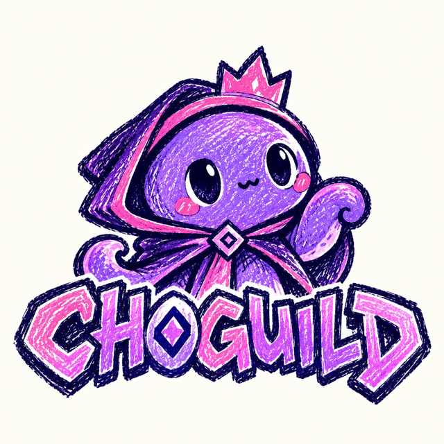

<p align="center">
  
</p>

<h1 align="center">Choguild</h1>

<p align="center">
  <strong>Show the work and wear the name.</strong><br />
  A contributor guild for the Monad ecosystem: a Passport for your name, a board of open work, and a record of reviewed contributions.
</p>

---

## What it does

| Area | What you can do |
| --- | --- |
| **Passport** | Connect a browser wallet, sign a message (Sign-In with Ethereum, never a transaction), and save a public Passport with your skills and links. |
| **Discover** | Browse the opportunity board. Search and filter by skill, category, compensation, and status. |
| **Opportunities** | Publish open work, edit your listings, and review the applications they receive. |
| **Applications** | Track what you applied to and where each application stands. |
| **Submissions** | Once accepted, submit evidence of the work. Reviewed submissions build your contribution history. |
| **Ranking** | The Chog ladder: every public Passport ranked by guild XP and onchain Monad activity, with Overall / Guild work / Onchain views and a top-3 podium. |
| **How it works** | The full loop, the XP table, the five ranks, and an FAQ. |
| **Network** | Live Monad mainnet status for the RPC the app uses. |

A connected wallet is only an address. Nothing is treated as an account until you sign and save a Passport, and Choguild never asks for a seed phrase or private key.

## XP and ranks

XP is calculated live from the database, so it can't drift out of sync with the board.

| Action | XP |
| --- | --- |
| Accepted submission | +100 |
| Accepted application | +25 |
| Published opportunity (not draft, not demo) | +15 |
| Saved public Passport | +10 |
| Onchain activity on Monad mainnet | 10 × √(transactions sent), up to +150 |

Onchain XP reads each Passport wallet's transaction count from the public Monad RPC (batched, cached for 10 minutes). The square root and the cap mean steady activity counts, but spamming transactions can't outrank reviewed guild work, and balances are never used. The Ranking page can sort by **Overall**, **Guild work**, or **Onchain**.

Ranks: **Hatchling** (0) → **Apprentice** (50) → **Artisan** (150) → **Guildmaster** (400) → **Legend** (1000). The rules live in `src/lib/ranking/xp.ts`.

## Getting around

- A **floating dock** at the bottom of every screen holds the main pages (Home, Discover, Ranking, Passport). Its **More** and **Account** buttons morph it open into panels for the remaining pages, quick actions, what's new, and your Passport status.
- **⌘K / Ctrl+K** opens a jump menu for every page and common action.
- The header has search, a **light/dark toggle**, and Wallet. Detail pages show a **Back** control.

## Design

- **Pure black by default, with a light theme.** The landing page always stays dark.
- **One violet** (`#7C3AED`) for primary actions and selected states. White labels on it pass WCAG AA, and every page passes an axe WCAG 2.1 AA audit in both themes.
- **The hero is a live 3D scene**: a tunnel of drifting dots drawn with plain WebGL (no 3D library). It follows the pointer slightly, pauses when scrolled away or when the tab is hidden, shows a still frame for `prefers-reduced-motion`, and falls back to a CSS dot pattern when WebGL is unavailable.
- Status badges use one shared mapping (`src/lib/status-tone.ts`): neutral, info, success, warning, danger.
- Every number on the landing page comes from the live database. Example listings are marked **Demo**.

## Tech stack

- [TanStack Start](https://tanstack.com/start) (React 19, file-based routing, server functions)
- Tailwind CSS v4, Radix UI primitives, Motion, `cmdk`, `lucide-react`; Geist and Geist Mono
- `wagmi` + `viem` for wallets and Monad; SIWE for Passport sessions
- Postgres via `pg` when `DATABASE_URL` is set, otherwise an in-memory [PGLite](https://pglite.dev) database
- Deployed on Vercel through Nitro

## Run it locally

Requires Node 22.

```bash
npm install
npm run dev        # http://localhost:8080
```

No database is needed for local work: PGLite starts in memory and applies `migrations/` on boot.

### Checks

```bash
npm run typecheck
npm run lint
npm run build
```

## Configuration

Copy `.env.example` into your host's environment settings. Do not commit real values.

| Variable | Required | Purpose |
| --- | --- | --- |
| `DATABASE_URL` | For persistent data | Postgres connection string (Neon works well). Without it, data lives in memory and resets when the server restarts. |
| `CHOG_SESSION_SECRET` | Yes, when `DATABASE_URL` is set | At least 32 random characters. Signs Passport sessions. |
| `VITE_MONAD_RPC_URL` | No | Override the public Monad RPC. |

## Deploy to Vercel

1. Import the repository in Vercel. The framework preset can stay on **Other**; `vercel.json` and the Nitro build output handle the rest.
2. Add `CHOG_SESSION_SECRET` (and `DATABASE_URL` if you want data to persist).
3. Deploy. `npm run build` runs the database migrations automatically when `DATABASE_URL` is present.

## Project layout

```
src/
  routes/          pages (file-based routing)
  components/      UI: layout shell, landing (3D hero), board, passport, work
  lib/board/       opportunities and applications
  lib/work/        submissions and reviews
  lib/passport/    profiles, SIWE sessions, wallet config
  lib/monad/       network status and onchain activity (tx counts)
  lib/ranking/     XP rules, tiers, and the ranking query
migrations/        SQL schema, applied in order
public/brand/      Chog mascot artwork
```

## License

No license has been chosen yet. All rights reserved by the repository owner until one is added.
